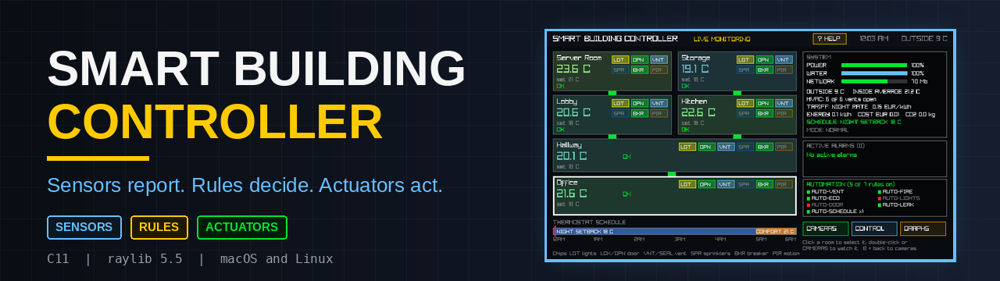
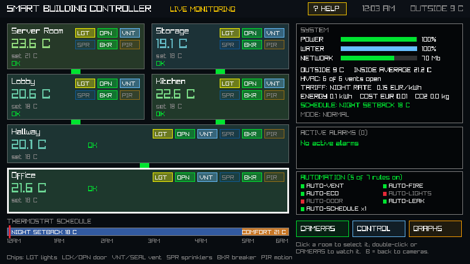
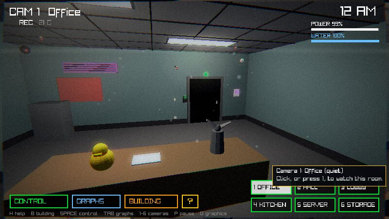
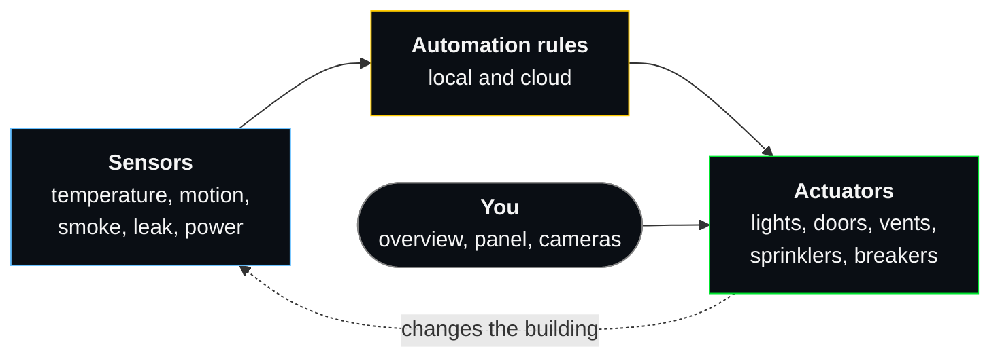
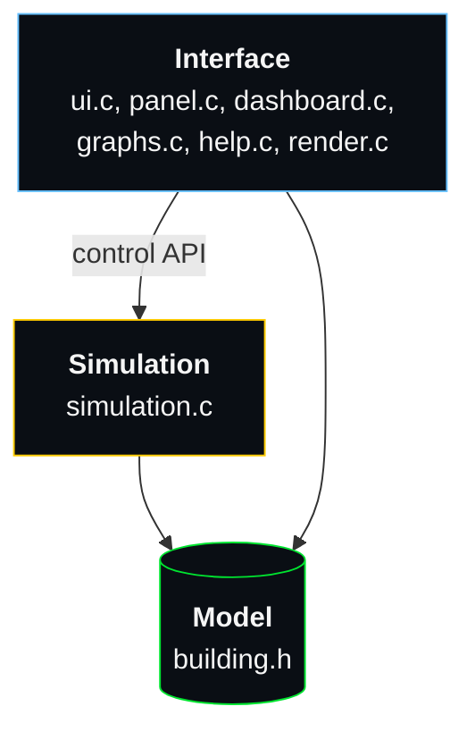

<p align="center">
  
</p>

<p align="center">
  
  
  
  
</p>

<p align="center">
  <b>A smart building controller written in plain C.</b><br>
  Sensors, actuators and automation rules for a simulated six-room building,<br>
  with a live building overview, a control panel and 3D camera views.
</p>

<p align="center">
  <a href="#how-it-works">How it works</a> &bull;
  <a href="#features">Features</a> &bull;
  <a href="#automation-rules">Automation</a> &bull;
  <a href="#getting-started">Getting started</a> &bull;
  <a href="#controls">Controls</a> &bull;
  <a href="#project-structure">Structure</a>
</p>

---

<table>
  <tr>
    <td width="50%"><br><sub><b>Building overview</b>: live readings, alarms and automation status</sub></td>
    <td width="50%"><br><sub><b>Camera view</b>: a 3D room you can click and control</sub></td>
  </tr>
</table>

## How it works

The project is built around the control loop used in every smart building: **sensors report, rules decide, actuators act.**



A smoke alarm rings, the fire rule seals the room and opens the sprinklers, and the action is written to the event log. If the internet goes down the cloud rules stop, but the local fire rule keeps working.

| | Examples |
|---|---|
| **Sensors** | Temperature, motion (PIR), smoke, water leak, door state, battery power, water tank, network speed |
| **Actuators** | Lights, door locks, vents (HVAC), sprinkler valves, circuit breakers, thermostat setpoints, main water valve |
| **Rules** | Seven automation rules, split into local (always works) and cloud (stops when the internet is down) |

### Architecture

The interface never changes the building directly. It only calls a small control API, so the simulation could be replaced by a layer that talks to real devices.



## Features

| | |
|---|---|
| 🏢 **Building overview** | Floor plan with live temperatures, status chips for every device, system meters, active alarms and automation status |
| 🎛️ **Control panel** | Room, Scenes, Auto, Utility and Log tabs |
| 🎥 **3D camera views** | Watch every room and click the door, lights, vent, sprinklers and thermostat |
| 📈 **Monitoring graphs** | Network speed, room temperatures, motion and ventilation |
| 🔥 **Fire model** | Ordinary, grease and electrical fires, flashover, backdraft, heat-activated sprinklers on a shared pump and tank |
| ⚡ **Random events** | Power surge, burst pipe, HVAC fault, internet outage, false alarm, door controller fault |
| 🌡️ **Smart home details** | Weather outside, night and morning tariffs, energy in kWh, cost in euro, CO2, per-room heat loads, circuit breakers |
| 🎬 **One-click scenes** | Lockdown, Eco, Fire Response and Reset |
| 💡 **Smart advisor and help** | One line of guidance for whatever matters most, plus help screens and hover hints |
| ✨ **Graphics and sound** | Lighting and post-processing shaders, all sound generated in code (no audio files) |

## Automation rules

| Rule | Type | What it does |
|---|---|---|
| `AUTO-FIRE` | 🟢 Local | Seals a room on a smoke or heat alarm, sprays ordinary fires, cuts power in electrical fires, releases the room when the fire is out |
| `AUTO-VENT` | ☁️ Cloud | Opens a vent when a room passes 26 °C |
| `AUTO-ECO` | ☁️ Cloud | Switches to ECO mode when the battery is below 25% |
| `AUTO-LEAK` | ☁️ Cloud | Closes the main water valve when a leak is sensed |
| `AUTO-SCHEDULE` | ☁️ Cloud | Night setback to 18 °C, comfort at 21 °C from 5 AM |
| `AUTO-LIGHTS` | ☁️ Cloud | Lights on when motion is seen in a dark room (off by default) |
| `AUTO-DOOR` | ☁️ Cloud | Locks the Office door while an intruder is near (off by default) |

> [!NOTE]
> **Local rules keep working without the internet.** Cloud rules pause during an outage, and the overview shows **CLOUD OFFLINE** until it comes back.

## Getting started

### Requirements

- A C compiler (`gcc` or `clang`) and `make`
- raylib 5.x

| System | Install raylib |
|---|---|
| 🍎 macOS | `brew install raylib` |
| 🐧 Arch Linux | `sudo pacman -S raylib` |

### Build and run

```sh
git clone https://github.com/kondzio123455/Smart-Building-Controller.git
cd Smart-Building-Controller/src
make clean && make && ./app
```

The Makefile detects macOS and adds the Homebrew paths automatically.

## Controls

| Key | Action |
|---|---|
| <kbd>1</kbd> – <kbd>6</kbd> | Camera for Office, Hall, Lobby, Kitchen, Server, Storage |
| <kbd>B</kbd> | Building overview |
| <kbd>Space</kbd> | Control panel |
| <kbd>Tab</kbd> | Monitoring graphs |
| <kbd>H</kbd> | Help |
| <kbd>P</kbd> | Pause |
| <kbd>G</kbd> | Fancy graphics on or off |
| <kbd>L</kbd> <kbd>D</kbd> <kbd>S</kbd> | Lights, door lock, sprinklers of the room being viewed |
| <kbd>Z</kbd> <kbd>X</kbd> <kbd>C</kbd> <kbd>V</kbd> | Scenes: Lockdown, Eco, Fire Response, Reset |
| <kbd>R</kbd> | Restart after the night ends |

## Project structure

<details>
<summary><b>Show the files</b></summary>

```
src/
├── building.h       shared data model: rooms, sensors, actuators, rules, log
├── simulation.c     physics, power, fire, sprinklers, events, scenes, automation rules
├── ui.c             3D camera views, lighting setup, input, sound synthesis
├── panel.c/.h       control panel
├── dashboard.c/.h   building overview
├── graphs.c/.h      monitoring graphs
├── render.c/.h      lighting and post-processing shaders, glow and smoke sprites
├── help.c/.h        help screens and hover hints
├── main.c           window and main loop
└── Makefile         build for macOS and Linux
```

</details>

## Limitations

- It is a simulation: there is no real hardware.
- Rule thresholds are fixed in code and settings are not saved between runs.

## Authors

Made by **Kondzio** and **Javier**, Year 3 Software Development, SETU Carlow, 2026.
